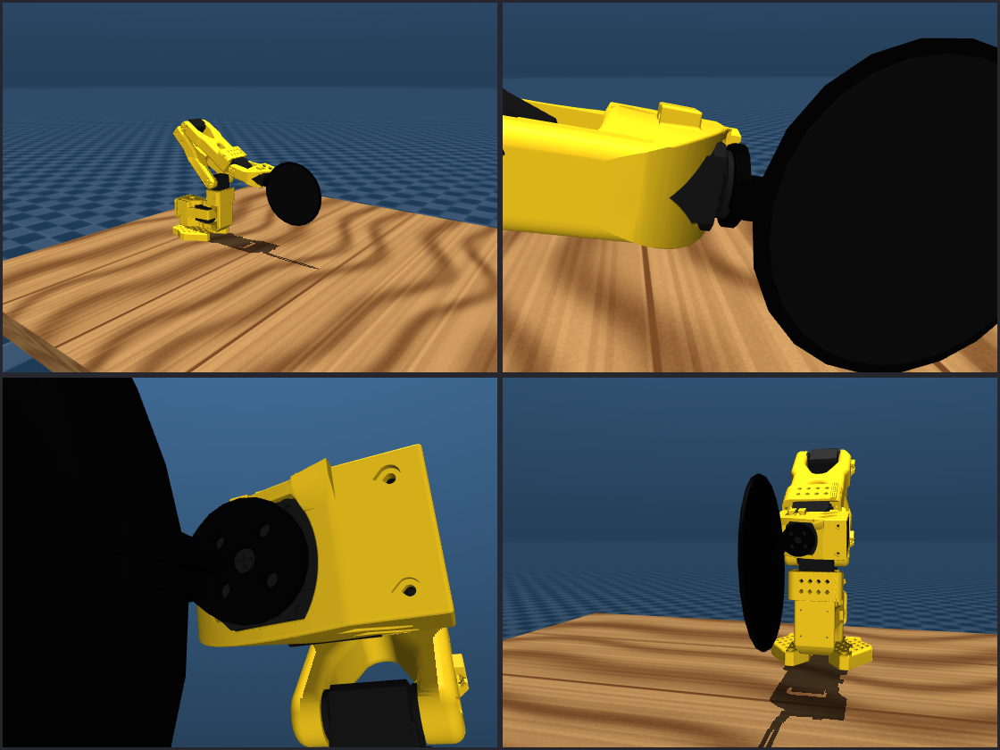

# The paddle

A 3D-printable ping-pong paddle that replaces an SO-101's gripper and bolts
straight onto the wrist_roll servo's horn, modelled
parametrically so the numbers can be argued with rather than reverse-engineered
out of a mesh.

|  |  |
|---|---|
| tool | [build123d](https://build123d.readthedocs.io) 0.13 (Python, scriptable, no GUI, no licence) |
| source | [`paddle.py`](paddle.py) - every dimension is a named constant at the top |
| blade | 110 mm diameter, 2.4 mm thick |
| mass | **30.5 g printed** in PLA (24.6 cm3), **+13.9 g** of rubber = **44.5 g** |
| what wrist_roll carries | **46 g** (paddle + horn), down from **156 g** with the gripper and old paddle |
| lever | blade centre **61 mm** from the horn face, down from 145 mm on the jaw |
| inertia about the wrist_roll axis | 3.59e-5 kg m2 |
| print | face-down, flat on the bed, **no supports** |
| fasteners | the **4x M3 x 6** that held the gripper on, into the horn |
| finish | painted matt black all over; the rubber is black too |

## Regenerate it

    uv pip install --python .venv/bin/python -r requirements-cad.txt
    .venv/bin/python cad/paddle.py

which rewrites, from the one script:

    cad/out/paddle.step            the solid, for FreeCAD / Fusion / SolidWorks
    cad/out/paddle.stl             3558 triangles, for the slicer
    sim/models/paddle/paddle.stl   942 triangles, for MuJoCo's visual geom
    cad/out/paddle_props.json      volume, mass, centre of mass, inertia

`sim/paddle.py` does **not** import build123d. Its `PaddleConfig` is a hand-copy
of that JSON, and `tests/test_paddle.py::test_config_matches_cad` fails if the
CAD is re-run and the copy is not updated. So: change a constant, re-run the
script, copy the four numbers it prints into `PaddleConfig`, run the tests.

    .venv/bin/python scripts/render_paddle.py        # rewrites the image above

## The big paddle

    .venv/bin/python cad/paddle.py --big

writes `cad/out/paddle_big.{step,stl}` and `paddle_big_props.json`: the same hub,
horn interface, gusset and 3 mm gap to the wrist bracket, on a **150 mm** blade
(a regulation blade's width). Both build checks - screw access and the wrist
bracket - pass on it too.

| | 110 mm | 150 mm |
|---|---|---|
| mass, printed + rubber | 30.5 + 13.9 = **44.5 g** | 54.7 + 27.2 = **81.9 g** |
| blade centre from the horn face | 61 mm | 81 mm |
| length, lip to tip | 117 mm | 157 mm |

It is **for printing only**. The sim, its tests and the trained policies all
use the 110 mm blade, and `--big` leaves the sim mesh and `paddle_props.json`
alone. Before running a policy with it on the real arm, know that:

- it puts about 2.5x the 110's first moment on the wrist - roughly what the
  gripper and the old jaw-mounted paddle did - so the wrist servos work harder;
- the 110 already comes within 1.4 mm of the upper arm at the top of wrist_flex
  (+95 deg, elbow folded), and the big blade reaches 20 mm further out, so keep
  wrist_flex well off its upper limit;
- the rim is 20 mm closer to the table at the same pose.

It needs a bed at least 160 x 155 mm. Print and finish it exactly as below.

## Why 110 mm

A regulation blade is about 150 mm across. Three things push back on that, and
only two of them turn out to matter.

*These numbers were worked out when the paddle bolted to the gripper's fixed jaw,
and the masses below are from that version. The argument is about the blade, so
it still holds. The horn-mounted paddle weighs about the same on its own
(44.5 g), but the arm carries 46 g beyond wrist_roll instead of 156 g, at less
than half the lever.*

**Inertia about the wrist: not the constraint.** A 110 mm blade adds 3.86e-5
kg m2 about the wrist_roll axis (3.59e-5 for the horn-mounted version). The STS3215's own reflected armature in the
vendored model is `armature="0.028"`, so the paddle is **0.14%** of what that
joint is already accelerating. At 150 mm it would be 1.30e-4, still only 0.41%.
Blade size is essentially free in wrist inertia, and any argument for a small
blade that leans on inertia is wrong.

**Mass and gravity torque: the constraint that is real.** Mass goes as the
square of the diameter, and it is bought straight out of joint speed, which is
already what limits us to ~1.0-1.5 m/s of paddle speed.

| blade | printed | + rubber | total | gravity torque at full extension (453 mm lever) | of the 2.94 N.m servo limit |
|---|---|---|---|---|---|
| 110 mm | 30.8 g | 13.9 g | **44.7 g** | 0.199 N.m | 6.8% |
| 150 mm | 55.1 g | 27.2 g | 82.3 g | 0.355 N.m | 12.1% |

44.7 g is 8.9% of the SO-101's ~500 g rating. 82 g is 16.5%, for a machine whose
binding problem is already that it is not fast enough.

**Table clearance: the argument that actually decides it.** The blade is a disc,
so when it is held vertical - which is how you block and drive - its rim reaches
one radius below its centre. At 55 mm the face centre can sit anywhere from 57 mm
up, which covers the strike band `sim/reach.py` works in (30-220 mm). At 75 mm it
cannot: a regulation blade held vertical with its centre at 120 mm has its rim
45 mm above the table, and anywhere in the lower half of the band it is through
the surface.

**What 110 mm buys, against the 15 mm end-effector error.** A clean face hit
needs the contact point at least a ball radius (20 mm) inside the rim. 55 - 20 =
35 mm of usable half-width, against a 15 mm positioning error: **20 mm of
margin**, better than 2x. At 90 mm it would be 25 - 15 = 10 mm and marginal; at
150 mm it would be 40 mm of margin, and the extra 20 mm costs 38 g and the table
clearance above.

**What was traded away:** forgiveness beyond +/-35 mm, and regulation feel. If
the real error turns out to be worse than 15 mm, raise `BLADE_DIA` - the mount,
the mass properties and the sim all follow from it - and pay for it in speed.

One thing the paddle *gives back*: it puts the hitting face 49 mm beyond the old
gripper frame, and `sim/reach.py` measured over the face instead of the gripper
frame goes from **66.6% of the arm's half (max x = 0.480 m)** to **73.4%
(max x = 0.526 m)**.

## How it mounts, and what is and is not confirmed

The **whole gripper comes off**: the fixed jaw (`wrist_roll_follower_so101_v1`),
the gripper servo inside it, the moving jaw and the wrist camera mount. The
paddle's own hub takes the fixed jaw's place on the wrist_roll servo's horn. That
takes 111 g off the end of the arm (87 g of fixed jaw and servo, 12 g of moving
jaw and 12 g of camera mount, per the upstream model). It also leaves
five servos on the bus instead of six, and puts the paddle on the stiffest thing
there is to put it on.

**What is confirmed.** The LeRobot SO-101 assembly guide says the gripper
attaches "to the motor horn on the wrist using 4 M3x6mm screws", driven from
the gripper side. The hub copies the fixed jaw's horn interface. It was measured
by slicing the vendored jaw mesh (`sim/models/so101/assets/wrist_roll_follower_so101_v1.stl`)
at its mating face and fitting circles to the sections:

| feature | jaw (measured) | horn it meets (`sts3215_03a_v1.stl`) |
|---|---|---|
| screw holes | 4x Ø3.20, on a Ø14.00 circle, at 45 deg | 4x Ø2.50 on Ø14.00, at 45 deg |
| centre | Ø5.40 through | Ø6 hub |
| plate | 3.0 mm | disc Ø20.0 x 2.1 mm |
| locating lip | r = 10.0-12.0 mm, 1.0 mm tall, open where gripper x < -3.7 mm | |

Ø3.2 clears M3 and Ø2.5 is an M3 tapping size, which agrees with the guide. A
3.0 mm plate is what makes the original M3 x 6 screws the right length, so the
same four go back in.

**What is not confirmed.** These numbers are measured off meshes, not taken from
a dimensioned drawing. TheRobotStudio does not publish one. Every number is a
named constant at the top of `paddle.py` (`HORN_HOLE_DIA`, `HORN_HOLE_PCD`,
`HORN_HOLE_ANGLES`, `HORN_CENTRE_DIA`, `HORN_LIP_R`, `HORN_LIP_OPEN_X`). **Put
calipers on the jaw you are taking off before you print**, correct the constants,
and re-run. Nothing else has to change.

**The one constraint that shapes the part.** The screws go in from the paddle
side, so every head needs a straight line back along the roll axis for a
screwdriver. So the gusset joining hub to blade is not a solid block down the
middle. It is a 4 mm web lying in the blade's own plane, with a 3 mm rib on its
back, and both pass *between* the four screw axes. `paddle.py` checks this on
the solid: a Ø5 driver along each screw axis must not touch the part, or the
build fails. `tests/test_paddle.py` repeats the check on the committed numbers.

That check covers the screwdriver's *shaft*. Its handle is another matter for
the two screws on the blade side of the axis: they sit 5 mm above the blade's
back, so a normal handle hits the blade. Drive those two with a long-shaft
driver (120 mm or more, so the handle is past the rim) or a ball-end key. The
other two take any driver.

**There is no stick.** The blade sits as close to the horn as the wrist allows.
The bracket that holds the wrist_roll servo (`wrist_roll_pitch_so101_v2`)
reaches 4.7 mm past the horn face, at 14.1 mm or more from the roll axis. Because
wrist_roll swings the paddle through +/-157 deg, nothing of the paddle outside
that radius may sit within that depth at any roll angle. So:

- the blade's rim starts 6 mm from the horn face (`BLADE_GAP`, 1.3 mm deeper than
  the bracket), and the blade centre is 61 mm from it;
- the hub and lip stand on 45 deg teardrop feet rather than square ones, so their
  corners stay inside 14 mm;
- the gusset is 12 mm wide where it leaves the hub.

`paddle.py` checks this on the solid too, and fails the build if anything strays
into the bracket's swept volume. Note that MuJoCo cannot catch this one: it does
not collide a link with its parent, so the sim would happily let the two
overlap.

**What the shorter lever buys, and costs.** The paddle's first moment about the
horn drops from 6.5 to 2.6 g m, which is what wrist_flex has to hold up against
gravity and swing. The cost is reach: measured over the face with
`sim.reach.reach_map`, the deepest the face gets across the strike band falls
from x = 0.526 m (73.4% of the arm's half) on the jaw-mounted paddle to
**x = 0.442 m (58.5%)**. That is less than the bare gripper frame's 0.480 m
(66.6%), because the face now sits beside the wrist instead of beyond it. If that
turns out to matter, `BLADE_GAP` buys reach back at about 1 mm per mm.

The face sits 12.5 mm off the roll axis on the wrist_roll link's -y side, and
the blade runs straight down the roll axis, not tilted 20 deg as it was on the
jaw. `PADDLE_HOME` is re-solved for this geometry. Re-measure anything tuned to
the old pose.

**Clocking.** Four holes at 90 deg mean it fits the horn four ways. Fit it so the
rubber faces the same way the old paddle's did. Then re-run the LeRobot
calibration for wrist_roll, because the horn's spline does not have to land
where the gripper's did.

## Printing it

**Orientation: hitting face down, flat on the bed. Nothing else.** Everything
else on the part - neck, pad, bosses - grows upwards from that face, so there is
not a single overhang and no supports are needed.

| setting | value | why |
|---|---|---|
| material | PLA | PETG if you keep cracking the gusset; it is ~4% heavier |
| nozzle / layer height | 0.4 mm / 0.2 mm | 0.15 mm if you want a nicer glue face |
| walls (perimeters) | **4** | 1.6 mm of the 2.4 mm blade is wall; this is what makes a 2.4 mm disc stiff |
| top / bottom layers | 4 / 4 | at 0.2 mm the blade is 12 layers, so it comes out effectively solid |
| infill | 40% gyroid | only the hub, rib and gusset have any interior at all |
| brim / raft | none | a 110 mm disc on the bed needs no help |
| supports | **none** | |

Print it on a smooth bed (PEI or glass). The first layer is the surface you are
going to glue rubber to.

Expect about 25 cm3, ~10 m of 1.75 mm filament, and 30.5 g.

The hub is a vertical plate standing on a teardrop foot: 45 deg flanks running
tangentially into its round top. Its screw holes are horizontal, which every
slicer prints without supports.

### Painting it black

- Paint the print, not the rubber. Paint on the hitting surface kills both grip
  and bounce. If you want the face black, buy a black sheet, which most are.
- Mask the face and paint before you glue. Contact cement wants bare plastic.
- Mask the hub's horn side and keep paint out of the five holes. A few tenths
  of a millimetre there is enough to stop the hub seating flat on the horn.
- Keep it light. A couple of grams of paint is noise; a thick coat starts
  showing up in the mass the arm carries.

### The rubber

The face is dead flat, not recessed. A recessed pocket would have to bridge a
100 mm span in mid-air on the first layer, which is the one thing this
orientation cannot do; a flat face is also what contact cement actually wants.
Instead there is an **annular groove, 1.0 mm wide and 0.6 mm deep, on a Ø103 mm
circle**, which is the trim line and a glue relief. Cut the sheet to Ø103 and the
groove tells you when you have it centred.

Use a thin sheet - a pips-out or short-pip rubber around 1.1-1.5 mm, no thick
sponge. The model assumes 1.2 mm at 1.45 g/cm3. This is not cosmetic: it is the
difference between a ball-off-PLA restitution of ~0.60 and ~0.85, i.e. most of
the return speed.

If you would rather have a real pocket, set `RUBBER_RECESS = RUBBER_THICK` in
`paddle.py`. It will need supports.

### Hardware

- **4 x M3 x 6 mm**, the ones that held the gripper on. They pass through the
  hub's Ø3.2 holes and thread into the horn.
- Unbolt the gripper servo's cable from the wrist_roll servo. Nothing replaces
  it, and the bus now ends at servo 5.
- Seat the horn in the lip, start all four screws, then tighten them in a cross
  pattern. You are clamping a printed plate against a plastic horn, so stop
  when it seats.

## Opening and editing it, from scratch

If all you want is to **print it**: `cad/out/paddle.stl` opens in any slicer
(PrusaSlicer, Bambu Studio, Cura, OrcaSlicer). Nothing else is needed.

If you want to **look at or modify the solid** without writing Python, open
`cad/out/paddle.step` in [FreeCAD](https://www.freecad.org) (free, macOS build,
no licence). STEP is a real solid, not a mesh, so it can be edited there.

If you want to **change the parameters**, which is the intended route:

1. `uv pip install --python .venv/bin/python -r requirements-cad.txt` - about
   400 MB, mostly OpenCascade. No GUI and no licence server.
2. Edit the constants at the top of `cad/paddle.py`.
3. `.venv/bin/python cad/paddle.py`.
4. Copy the mass, centre of mass and inertia it prints into
   `sim.paddle.PaddleConfig`, and re-run `pytest tests/test_paddle.py`.

For a live 3D preview while editing, `uv pip install ocp_vscode` plus the
"OCP CAD Viewer" VS Code extension, then `show(part)`. Optional - the script does
not import it.
